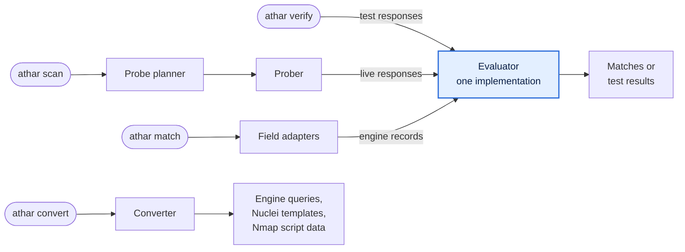

# athar CLI

The reference implementation of the Athar rule format: one Go binary that verifies, converts and evaluates rules, and scans live services.

> **Status:** `athar verify`, `athar scan` and `athar convert` work. `match` is planned; its flags below are the target design and may change.

[docs/decisions.md](../docs/decisions.md#cli-in-go) explains why the CLI is written in Go.

## Install and use

Release binaries, `go install` and the `verify` flags are described in the [main README](../README.md#cli).

Not supported yet: tests for custom probes, and `jsonpath` beyond dotted paths such as `$.build.version`.

## Develop

The Go module sits at the repository root (`go.mod`), so one version tag versions the spec, the rules and the CLI together. Requires Go 1.25 or newer. From the repository root:

```bash
go test ./...
```

If `nuclei` is on the `PATH`, `go test` also converts every rule to a Nuclei template and runs it against local servers that answer like the rule's tests. If `nmap` is, it does the same with `athar.nse`, and runs `athar scan` and `athar.nse` on the same raw responses to check that they read every field alike. `go test -short` skips these.

```bash
go run ./cli/cmd/athar verify -strict rules
```

```bash
go build -o athar ./cli/cmd/athar
```

## Release

Push a version tag. The [release workflow](../.github/workflows/release.yml) runs the tests and `athar verify -strict rules`, builds archives for Linux, macOS and Windows (amd64 and arm64) with [scripts/build-release.sh](../scripts/build-release.sh), and publishes them with `checksums.txt` and generated release notes on the [releases page](https://github.com/Athar-HQ/Athar/releases).

```bash
git tag -a v0.1.0 -m "Athar v0.1.0"
```

```bash
git push origin v0.1.0
```

Tags with a suffix, such as `v0.2.0-rc.1`, become pre-releases. The binary reports the tag in `athar version`. To try the build locally, run `scripts/build-release.sh v0.0.0-test /tmp/athar-dist`.

## Commands

Every command takes rules plus its own input. None of them depends on another command having run first.

| Command | Input | Output | Sends packets |
| --- | --- | --- | --- |
| `athar verify` | Rule files or folders | Schema errors, lint findings, test results; non-zero exit on failure | No |
| `athar scan` | Rules + hosts, CIDR ranges or `host:port` + ports | Matched services (readable lines, or JSONL with `-json`) | Yes |
| `athar convert` | Rules + engines, `nuclei` or `nse` (`-t`) | One query, Nuclei template or `athar.nse` data file per rule and target, with fidelity and notes (JSON with `-json`, files with `-o`) | No |
| `athar match` (planned) | Rules + stored data (engine exports, recorded responses) | Matched records (JSONL) | No |

Example session (`verify`, `scan` and `convert` output is real; `match` is planned, not built yet):

```text
$ athar verify rules/
rules/offensive-tool/aof_artex_antifox_nov26.yml                 4/4 tests passed
rules/offensive-tool/aof_artex_artex_favicon_nov26.yml           3/3 tests passed
rules/offensive-tool/aof_artex_artex_nov26.yml                   5/5 tests passed
rules/offensive-tool/aof_artex_basic_auth_nov26.yml              2/2 tests passed
rules/offensive-tool/aof_artex_frontend_files_nov26.yml          6/6 tests passed
rules/offensive-tool/aof_artex_llm_console_nov26.yml             3/3 tests passed
rules/offensive-tool/aof_artex_nov26.yml                         7/7 tests passed
rules/offensive-tool/aof_artex_opx_nov26.yml                     3/3 tests passed
rules/offensive-tool/aof_artex_rebrands_nov26.yml                7/7 tests passed
rules/offensive-tool/aof_artex_stylesheet_nov26.yml              4/4 tests passed
rules/offensive-tool/aof_autocve_favicon_nov26.yml               2/2 tests passed
rules/offensive-tool/aof_autocve_favicon_sha256_nov26.yml        2/2 tests passed
rules/offensive-tool/aof_autocve_nov26.yml                       2/2 tests passed
rules/offensive-tool/aof_cairn_cert_nov26.yml                    2/2 tests passed
rules/offensive-tool/aof_cairn_cert_org_nov26.yml                2/2 tests passed
rules/offensive-tool/aof_cairn_nov26.yml                         6/6 tests passed
rules/offensive-tool/aof_cyberstrikeai_cert_nov26.yml            2/2 tests passed
rules/offensive-tool/aof_cyberstrikeai_favicon_nov26.yml         2/2 tests passed
rules/offensive-tool/aof_cyberstrikeai_favicon_sha256_nov26.yml  2/2 tests passed
rules/offensive-tool/aof_cyberstrikeai_nov26.yml                 3/3 tests passed
rules/offensive-tool/aof_cyberstrikeai_wordmark_nov26.yml        3/3 tests passed
rules/offensive-tool/aof_deepaudit_favicon_nov26.yml             2/2 tests passed
rules/offensive-tool/aof_deepaudit_favicon_sha256_nov26.yml      2/2 tests passed
rules/offensive-tool/aof_deepaudit_nov26.yml                     2/2 tests passed
rules/offensive-tool/aof_pentagi_cert_nov26.yml                  3/3 tests passed
rules/offensive-tool/aof_pentagi_cert_san_nov26.yml              2/2 tests passed
rules/offensive-tool/aof_pentagi_favicon_nov26.yml               4/4 tests passed
rules/offensive-tool/aof_pentagi_favicon_sha256_nov26.yml        4/4 tests passed
rules/offensive-tool/aof_redamon_favicon_nov26.yml               3/3 tests passed
rules/offensive-tool/aof_redamon_favicon_sha256_nov26.yml        3/3 tests passed
rules/offensive-tool/aof_redamon_nov26.yml                       2/2 tests passed
rules/offensive-tool/aof_strix_favicon_nov26.yml                 2/2 tests passed
rules/offensive-tool/aof_strix_favicon_sha256_nov26.yml          2/2 tests passed
rules/offensive-tool/aof_strix_nov26.yml                         2/2 tests passed
rules/offensive-tool/aof_strix_server_nov26.yml                  2/2 tests passed

35 rules, 0 failed; 107/107 tests passed; 0 errors, 0 warnings

$ athar scan -r rules/ -json -p 80,443,18080 127.0.0.0/30 > matches.jsonl
warning: 1 rule(s) declare custom probes, which are only sent with -probes; selections on them never match
athar scan: 4 hosts, 12 checks, 1 open, 1 match in 3.1s

$ athar convert -t fofa,modat rules/offensive-tool/aof_artex_nov26.yml
Agentic Offensive Framework - ARTEX family  rules/offensive-tool/aof_artex_nov26.yml
  fofa     exact        title="自主渗透测试控制台" || title="자율 침투 테스트 콘솔" || title="Autonomous Penetration Testing Console"
  modat    exact        http.title~"自主渗透测试控制台" or http.title~"자율 침투 테스트 콘솔" or http.title~"Autonomous Penetration Testing Console"

$ athar match -r rules/ --format fofa fofa-export.json > candidates.jsonl
```

## Scanning

`athar scan` works like a small Nmap whose service detection is the Athar rules:

```bash
athar scan -r rules/ -p 80,443,8000-8100 10.0.0.0/24 192.0.2.10 example.org
```

1. **Targets.** IP addresses, hostnames and CIDR ranges (up to /16) as arguments, or one per line with `-iL <file>` (`-` for stdin). A `host:port` target is checked on that port only, so the output of `athar match` or a port scanner can be fed in directly. A target given twice, or one inside a given range, is checked once. A number that is not an IP address, such as `10.0.1`, is refused, and a hostname that does not resolve is skipped with a warning. Checks go port by port across all hosts, in a spread order, so consecutive connections go to hosts far apart (different /24s of a /16) rather than to neighbours.
2. **Ports.** `-p` takes a list and ranges, as in Nmap: `-p 22,80,443,8000-8100`. Without `-p`, scan checks a built-in list of 106 ports plus every port the loaded rules name in `target.ports`. The list holds ports where the baseline probe can see something: common services, alternative web ports and admin consoles, container and infrastructure APIs, AI and LLM tools, and C2 and offensive tools. `athar scan -h` prints it.
3. **Open ports.** A TCP connect to each host and port, with a 1.5 s timeout (`-connect-timeout`), long enough for one SYN retransmission. This needs no root privileges; ports that refuse or time out are skipped.
4. **Fingerprint.** The scanner only collects what the loaded rules use, except TLS, which it always tries:
   - **Banner**, only when a rule's `target.protocol` is not `http`, or when a rule reads `service.banner`, `service.protocol` or an `ssh.` field or has a `keywords` selection: wait up to 2 seconds for the server to speak first (SSH, FTP, SMTP). A banner ends the baseline probe for that port. One such rule adds the wait to every open port that sends no banner, web servers included.
   - **TLS** on the same, still unused connection, always, because `target.tls` can't be honoured without it: certificate fields, version and cipher. SNI is sent only for hostname targets, and no ALPN protocol is offered. A service that answers in TLS but whose certificate or parameters Go's TLS library refuses is still recorded as TLS and gets no plaintext request; its certificate is read where TLS 1.2 or older shows it, the hashes even when it can't be parsed.
   - **HTTP** `GET /` over TLS or plaintext, without following redirects. The `Host` header is the target as given. Interim 1xx responses are skipped. Body is kept up to 1 MiB, and the title, headers, raw header block and body hashes are computed. The hashes are of the complete body, read up to 16 MiB; a body that is longer or cut short has none. A body in another charset than UTF-8 is decoded for the title and the body text if the response declares the charset: in the `Content-Type` header, a `<meta>` tag or a UTF-16 byte order mark. The hashes are over the bytes as received.
   - **Favicon**, only when a rule uses `http.favicon.*`: from `<link rel="icon">` (also inline `data:` icons), else `/favicon.ico`; a link without a path, such as `href="#"`, counts as none, and icons on other hosts are not fetched.
   - **Custom probes** declared by rules, only with `-probes`. Each distinct probe is sent once per port, however many rules use it. A TCP probe's `read.timeout_ms` can shorten the read, not extend it past `-timeout`.
5. **Match.** Every rule is evaluated on the responses, honouring `target.tls` (`required`, `none`). Each matching service is written as one line: a readable line with target, title, category, confidence and extracted values (coloured on a terminal), or with `-json` a JSON object that also has the rule id, product, family and matched selections. The readable line shows control characters in extracted values as escapes such as `\x1b`, so a service can't write to the terminal; JSON keeps the value. A service that several rules match gets one line per rule, ordered by confidence. When a variant and its family both match, only the variant is written, if `athar verify` could check that the variant implies its family (spec section 8); otherwise both are. The variant's line then also carries the values the family extracted; a value the variant extracts itself wins.

At start, scan warns about rules it can't fully evaluate. Not collected yet: `tls.alpn`, `tls.jarm`, `tls.ja3s`, `tls.ja4s`, `tls.cert.ja4x`, `ssh.hostkey.sha256`, `ssh.kex_algorithms`, and `x-<engine>.` fields. UDP rules are skipped.

Defaults that keep scanning polite and safe:

- Baseline probe only. Custom probes run only with `-probes`, and only if they are safe: GET, HEAD or OPTIONS, a path that starts with `/`, no line breaks in the path or headers, and no credential, body or method-override headers (`Authorization`, `Cookie`, `Content-Length`, `X-HTTP-Method-Override`, …). A `tcp` probe whose payload contains an HTTP request that breaks these rules isn't sent either, nor is a probe whose protocol is not `http` or `tcp` or whose payload can't be decoded. `athar verify` reports such probes as errors, so `athar scan` refuses to load the rule.
- At most 200 new connections per second (`-rate`), 500 parallel checks (`-c`), 8 per host (`-per-host`).
- The HTTP `User-Agent` names the tool: `Mozilla/5.0 (compatible; athar/<version>; +https://github.com/Athar-HQ/Athar)`.
- Ranges larger than /16 are refused; split them.
- Ctrl-C stops the scan; matches found so far are already written.

Exit codes: `0` scan completed (with or without matches), `2` usage error, invalid rules, no target that resolves, or interrupted.

Speed is set by `-rate`. Most addresses on the internet don't answer at all, so each check waits for the connect timeout, and `-c` must cover rate × timeout (200 × 1.5 s = 300) for the scan to reach its rate. With the defaults and the 106 built-in ports, a /24 takes a little over 2 minutes and a /16 about 10 hours. To sweep large ranges or all ports, find open ports with a fast port scanner you are allowed to run at that rate, and pass them as `host:port` lines; `-iL` reads all lines before the scan starts:

```bash
naabu -host 10.0.0.0/16 -top-ports 1000 -silent | athar scan -r rules/ -iL -
```

```bash
masscan 10.0.0.0/24 -p1-65535 --rate 1000 -oL open.txt && awk '$1 == "open" {print $4 ":" $3}' open.txt | athar scan -r rules/ -iL -
```

UDP scanning and raw SYN scanning are out of scope for the first version.

## Architecture

Each command is its own path through the code. Three of them end in the same evaluator.



`verify` (rule tests), `scan` (live responses) and `match` (engine records) all call the same evaluator, so a rule means the same thing everywhere. That is what keeps approximate conversions honest: `convert` only translates, and anything it lets through is judged by the evaluator later.

- **Probe planner** expands targets and ports and works out which parts of the baseline probe the rules need and which custom probes to send, like Nuclei's template clustering, so each open port gets each request once.
- **Prober** does the TCP connect check, sends the baseline probe and any opt-in probes, then computes the hashes: favicon mmh3, MD5 and SHA-256, body mmh3 and SHA-256. JARM and JA3S are planned.
- **Field adapters** map engine exports (FOFA, Shodan, Censys, ZoomEye, Modat, urlscan) into taxonomy fields.
- **Converter** builds one boolean expression from the condition and selections, pushes negations down to single conditions, lets each engine backend translate them, and replaces what an engine can't express with TRUE so the query can only over-match (the superset rule). Each result is labelled `exact`, `approximate`, `superset` or `unsupported`, with notes. The Nuclei backend renders the same expression as one DSL matcher and sends the requests its terms read: the baseline, the favicon, custom probes, and an `ssl` block for certificate fields. The NSE backend writes the same expression as Lua data for `athar.nse`, a hand-written Nmap script that probes and parses as the prober does, except that it doesn't decode charsets and matches a page that is not UTF-8 on its raw bytes; regular expressions travel as programs compiled by Go's `regexp/syntax`, which the script runs on a small Pike VM.
- **Evaluator** is a Sigma condition engine plus extraction, over taxonomy fields.

## Layout

All Go code lives in this folder; the module file (`go.mod`, module `github.com/Athar-HQ/Athar`) sits at the repository root. The only dependency is the YAML parser.

```text
cli/
├── cmd/athar/            main and subcommand wiring
└── internal/
    ├── rule/             load YAML, check metadata against the spec
    ├── condition/        Sigma condition parser
    ├── eval/             the evaluator: modifiers, keywords, probes, extraction, rule tests
    ├── fields/           field taxonomy (engine export adapters later)
    ├── probe/            targets and ports, prober (TCP, TLS, HTTP, favicon, banner, custom probes), hashes
    ├── scan/             scan runner: probe planning, rate and per-host limits, rule evaluation, precedence
    ├── output/           identity records as readable lines or JSONL
    ├── color/            ANSI colours, only on terminals and without NO_COLOR
    └── convert/          rule to query: expression tree, superset rule, one backend per engine (fofa, shodan, censys, zoomeye, modat, urlscan, huntio), Nuclei templates, athar.nse and its rule data
```

Packages stay under `internal/` until the API settles. The evaluator is the first candidate to become public, so other tools can embed Athar rules.

## Build order

1. ~~`rule`, `condition`, `eval` and `athar verify`~~ (done): the evaluator defines what rules mean, and CI needs it first.
2. ~~`probe`, `scan`, `output` and `athar scan` for TCP, TLS and HTTP~~ (done). Next for scan: JARM, JA3S, SSH host key and key exchange.
3. ~~`convert` and `athar convert` for FOFA, Shodan, Censys, ZoomEye, Modat, urlscan.io and Hunt.io~~ (done), Nuclei templates (done) and Nmap NSE (done), including Censys header search. Other targets are in [docs/conversion-targets.md](../docs/conversion-targets.md).
4. `fields` adapters and `athar match`.
